<div align="center">
  
</div>

## ▸ profile

B.Tech Computer Science student at Vishwakarma University, Pune (2027). I build ML systems that actually ship — models wrapped in typed FastAPI services, React frontends that survive real users, and packaging that runs fully offline when the network can't be trusted.

Currently **ML & Full-Stack Intern at Wilo Mather and Platt**, where I built a pump-sizing platform that predicts impeller trim diameter to **0.99 mm MAE** using physics-informed losses.

`10K+` users on a platform I built · `0.99 mm` model error · `300+` problems solved

## ▸ selected work

### Faculty Development Program Platform
`live` · [vu-fdp.vercel.app](https://vu-fdp.vercel.app)

A 14-microservice SaaS that runs faculty development programs end to end — multi-role RBAC, real-time Firestore sync, batch certificate generation through the Google Drive API, and DOCX/PDF/CSV reporting for administrators.

`React` `TypeScript` `Node/Express` `Flask` `Firestore`

**10K+ users** · **40+ events** · **99.9% availability** · **40% less admin overhead**
Registered copyright, Government of India — `LD-20250174733`

### SCDO — Syllabus & Curriculum Design Optimizer
[`Jayashri2908/Syllabus-Optimizer`](https://github.com/Jayashri2908/Syllabus-Optimizer)

An AI system that parses syllabi from PDF/DOCX/TXT into structured data, runs Bloom's-taxonomy and CO-PO gap analysis, and generates corrected syllabi. LLM semantic mapping with a rule-based fallback, plus export to PDF, Excel, LaTeX, Word, and JSON.

`Python` `FastAPI` `React` `TypeScript` `ChromaDB` `OpenRouter` `Gemini`

RAG pipeline with primary/fallback model routing · multi-format export · MIT licensed

### ML-Based Baldness Prediction System
*Manuscript and patent under review*

A model estimating baldness probability from genetic markers, lifestyle, and physiological signals, extended into an age-specific predictor with OpenCV scalp analysis and pattern recognition.

`Python` `scikit-learn` `OpenCV` `Computer Vision`

## ▸ experience

**ML & Full-Stack Intern** — Wilo Mather and Platt, Pune · *Jan 2026 – Present*

Built a pump-sizing platform that predicts impeller trim diameter, then shipped it as something a non-engineer can install and run.

- **0.99 mm MAE** on impeller trim prediction using TabM and XGBoost with physics-informed losses derived from affinity-law residuals
- FastAPI backend with 12 REST endpoints, Pydantic v2 validation, API-key auth, and SQLite persistence
- React 19 + TypeScript frontend, 25+ components, ApexCharts visualisation, PDF/DOCX export, SSE-streamed results
- Packaged as a Windows desktop app (Electron + NSIS installer) with GPU/CPU detection and zero-egress local inference
- KD-Tree analog search returning nearest historical cases in **under 10 ms**, served CPU-only

## ▸ stack

**languages** `Python` `TypeScript` `Java` `C++` `C` `SQL` `JavaScript`<br>
**ai / ml** `PyTorch` `scikit-learn` `CatBoost` `LightGBM` `OpenCV` `LangChain` `RAG pipelines` `Generative AI`<br>
**web** `React 19` `FastAPI` `Node/Express` `Django` `Flask` `Vite` `Tailwind CSS` `Three.js`<br>
**data** `PostgreSQL` `Firestore` `SQLite` `ChromaDB` `Redis` `Power BI`<br>
**infra** `Docker` `WebSockets` `SSE` `n8n` `Git` `Linux/Unix` `REST APIs` `Electron`

## ▸ currently

```
building   ML pump-sizing platform @ Wilo
learning   RAG pipelines · LLM evaluation · agent tooling
shipping   SCDO — LLM + RAG syllabus optimizer
```

## ▸ credentials

- **Certifications** — AWS Academy Cloud Architecting · IBM Full Stack Software Developer
- **Publication** — *Tracing the Evolution of AI and ML in Oncology: A Systematic Metadata Analysis*, ICSCDS 2025 · [DOI 10.1109/ICSCDS65426.2025.11167501](https://doi.org/10.1109/ICSCDS65426.2025.11167501)
- **Copyright** — *A Comprehensive Management System for Educational and Professional Development Programs*, Copyright Office of India, `LD-20250174733`
- **Hackathon podiums** — Band of Agents 2026 · Flipkart Grid 2.0 · IBM Watson Hackathon
- **Problem solving** — 300+ LeetCode problems across DSA, OS, OOP, and computer architecture
- **Community** — Visionary Core Member, Vishwakarma University Visionary Club (2024 – present)

## ▸ reach

<p align="center">
  <a href="mailto:jayashriutrankar@gmail.com"></a>
  <a href="https://www.linkedin.com/in/jayashri29"></a>
  <a href="https://github.com/Jayashri2908"></a>
  <a href="https://leetcode.com/u/Jayashri29/"></a>
</p>
